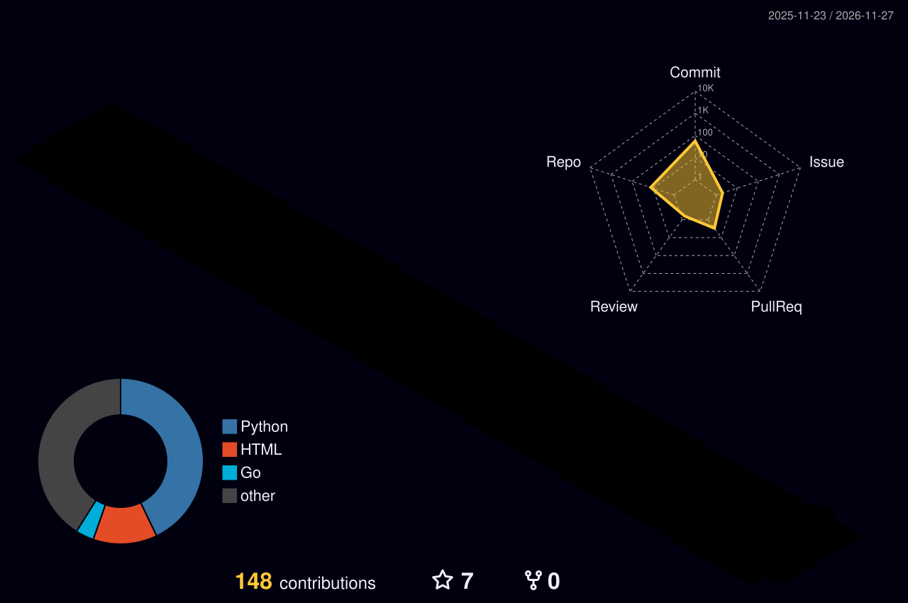

<!-- 3D ANIMATED HEADER -->

 

# 👋 WELCOME TO MY DIGITAL UNIVERSE

### `SOFTWARE DEVELOPER` ◆ `PROBLEM SOLVER` ◆ `TECH ENTHUSIAST`

 

  

---

<!-- ABOUT ME -->

<h2 align="center">🌌 THE DEVELOPER BEHIND THE CODE</h2>

I'm **Samuel Ogada**, a passionate software developer interested in building meaningful technology, solving problems, and exploring the possibilities of Artificial Intelligence.

I believe technology is more than writing code.

It's about transforming imagination into reality through innovation, creativity, and engineering.

### 🧬 MY DEVELOPER DNA

- 💻 Software Engineering and Development.
- 🐍 Python Development.
- 🐹 Go Programming.
- 🤖 Artificial Intelligence and Machine Learning.
- 🧠 Problem Solving and Logical Thinking.
- 🚀 Building Projects and Exploring Emerging Technologies.

---

<!-- TECHNOLOGY -->

<h2 align="center">⚡ MY TECHNOLOGY DIMENSION</h2>

### 💻 PROGRAMMING LANGUAGES

  

### 🛠️ DEVELOPMENT TOOLS

  

### 🧠 EXPLORING THE FUTURE

---

<!-- CURRENT MISSION -->

<h2 align="center">🚀 CURRENT MISSION CONTROL</h2>

| 🚀 Mission | 📡 Current Status |
|:---|:---|
| 🐍 Python Development | 🟢 Learning & Building |
| 🐹 Go Programming | 🟢 Improving |
| 🤖 Artificial Intelligence | 🟡 Exploring |
| 🌐 Web Development | 🟢 Learning |
| 🧩 Problem Solving | 🟢 Practising |
| 💡 Software Engineering | 🟢 Growing |

---

<!-- GITHUB ANALYTICS -->

<h2 align="center">📊 GITHUB PERFORMANCE MATRIX</h2>

  

---

<!-- 3D CONTRIBUTION GRAPH -->

<h2 align="center">🌌 MY 3D CONTRIBUTION UNIVERSE</h2>

 

### ⚡ EVERY CONTRIBUTION BUILDS MY DIGITAL LEGACY

---

<!-- CONTRIBUTION SNAKE -->

<h2 align="center">🐍 CONTRIBUTION SNAKE DIMENSION</h2>

---

<!-- TROPHIES -->

<h2 align="center">🏆 ACHIEVEMENTS & DEVELOPER TROPHIES</h2>

---

<!-- PROJECTS -->

<h2 align="center">🚀 PROJECTS FROM MY DIGITAL LAB</h2>

  

### 💡 MORE PROJECTS. MORE IDEAS. MORE INNOVATION.

---

<!-- PHILOSOPHY -->

<h2 align="center">🧠 MY DEVELOPER PHILOSOPHY</h2>

 

> "Great developers are not those who know everything, but those who never stop learning, questioning and building."

### THINK ◆ CODE ◆ CREATE ◆ INNOVATE

---

<!-- CONNECT -->

<h2 align="center">🌐 CONNECT TO MY NETWORK</h2>

  

### ⚡ THANKS FOR VISITING MY DIGITAL UNIVERSE

**Building the future, one line of code at a time.**

